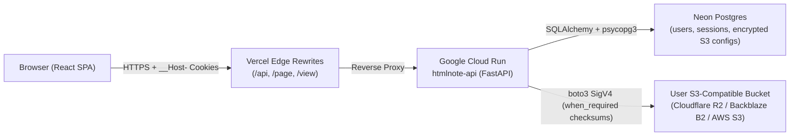

# HTMLNote API

[](https://github.com/tomar-ayush/htmlnote-api/actions/workflows/ci-cd.yml)


Multi-tenant FastAPI backend for **HTMLNote** — an HTML-native notebook built for AI agents, LLMs, and humans who want rich interactive documents stored cleanly in their own S3-compatible object storage.

Companion frontend repository: **[tomar-ayush/htmlnote-web](https://github.com/tomar-ayush/htmlnote-web)**

---

## Why HTMLNote?

LLMs and coding agents consistently generate richer, cleaner, and less lossy structure in **standalone `.html` documents** than in Markdown — tables, callouts, diagrams, inline styles, SVGs, and interactive widgets render natively without bespoke plugins or broken syntax conversions.

HTMLNote gives every account a private, multi-tenant notebook workspace backed by **Bring-Your-Own S3-Compatible Storage**:
- Store notes directly as portable `.html` files in **Cloudflare R2**, **Backblaze B2**, **AWS S3**, **MinIO**, **DigitalOcean Spaces**, or any S3-API provider.
- Drop `.html` or `.htm` files straight into your bucket from any AI agent or CLI script (`[prefix/]<notebook>/<section>/<page>.html`) and they appear automatically in your workspace tree.
- Keep the compute tier **100% stateless** for zero-cost serverless deployment on **Google Cloud Run** + **Neon Serverless Postgres**.

---

## Architecture



---

## Key Features & Security Model

- **Universal S3 Compatibility (`app/store.py`)**: Configured with `signature_version="s3v4"`, `request_checksum_calculation="when_required"`, and `response_checksum_validation="when_required"` so `PutObject`, `CopyObject`, and `DeleteObjects` work seamlessly across AWS S3, Cloudflare R2, and Backblaze B2 without checksum header rejections.
- **Encrypted Credentials at Rest (`app/storage.py`)**: Per-tenant `secret_key_enc` is encrypted with Fernet (`cryptography`) derived from `SECRET_KEY` before saving to Postgres and is never returned in API responses.
- **SSRF Protection (`validate_endpoint`)**: Blocks plain HTTP (unless `ALLOW_INSECURE_S3=true`), embedded credentials, query/path injection, and any resolved loopback, RFC1918 private, link-local (`169.254.169.254`), or non-global IP addresses.
- **Authentication & CSRF (`app/auth.py`)**: `scrypt` password hashing, timing-safe token verification, login brute-force throttling, `__Host-hn_session` `HttpOnly` cookies, double-submit `__Host-hn_csrf` + `X-CSRF-Token` validation, and `ALLOWED_ORIGINS` verification for Vercel Edge Rewrites.
- **Dual Content-Security-Policy Sandboxing (`app/main.py`)**:
  - Edit mode (`/page/{path}`): `script-src 'none'; object-src 'none'; base-uri 'none'`
  - Preview mode (`/view/{path}`): `sandbox allow-scripts allow-popups allow-modals`
- **Automatic Version History**: Snapshots previous `.html` revisions under `.versions/<notebook>/<section>/<page>.html/<timestamp>.html` (5-minute cadence or forced on restore, retaining the latest 10 versions).

---

## S3 Bucket Layout

```text
[S3_PREFIX/]
├── <notebook>/
│   ├── .keep
│   └── <section>/
│       ├── .keep
│       └── <page>.html
└── .versions/
    └── <notebook>/
        └── <section>/
            └── <page>.html/
                └── <epoch_ms>.html
```

External agents or automation scripts only need to upload `[S3_PREFIX/]<notebook>/<section>/<page>.html` — HTMLNote discovers the notebook, section, and page automatically without requiring `.keep` marker files.

---

## API Reference

| Method | Endpoint | Description |
|---|---|---|
| `GET` | `/healthz` | Container health probe (`{"ok": true}`) |
| `GET` | `/api/auth/me` | Return active user & issue CSRF cookie |
| `POST` | `/api/auth/signup` | Create user account and start session |
| `POST` | `/api/auth/login` | Authenticate user with rate-limiting |
| `POST` | `/api/auth/logout` | Revoke session and clear cookie |
| `GET` | `/api/storage` | Get masked S3 configuration for current user |
| `POST` | `/api/storage/test` | Verify list, put, and delete permissions against S3 |
| `PUT` | `/api/storage` | Verify, encrypt secret key, and save S3 configuration |
| `DELETE` | `/api/storage` | Disconnect saved S3 configuration |
| `GET` | `/api/tree` | List notebooks, sections, and pages from bucket |
| `POST` | `/api/folder` | Create notebook (`parent=""`) or section (`parent="<nb>"`) |
| `POST` | `/api/page` | Create `.html` page inside a section |
| `PUT` | `/api/page?path=...` | Update page HTML and optionally force version snapshot |
| `POST` | `/api/rename` | Rename notebook, section, or page (including versions) |
| `DELETE` | `/api/item?path=...` | Delete notebook, section, or page (preserving parent markers) |
| `GET` | `/api/versions?path=...` | List up to 10 saved page versions |
| `GET` | `/api/version?path=...&id=...` | Fetch HTML for a specific saved version |
| `GET` | `/page/{path}` | Serve raw HTML with script-disabled edit CSP |
| `GET` | `/view/{path}` | Serve HTML inside sandboxed view CSP |

---

## Local Development & Tests

```bash
python3.13 -m venv .venv
source .venv/bin/activate
pip install -r requirements.txt

cp .env.example .env
# Edit .env with your Neon DATABASE_URL (keep COOKIE_SECURE=false locally)

alembic upgrade head
uvicorn app.main:app --reload --port 8000
```

Run the test suite (uses an in-memory SQLite database and an in-process S3 HTTP server):

```bash
python -m unittest discover -s tests -v
```

---

## Deploying to Google Cloud Run + Neon

### 1. Environment Variables

| Variable | Required | Default | Description |
|---|---|---|---|
| `DATABASE_URL` | Yes | — | Neon Postgres URL (`postgresql://...` and `postgres://...` are automatically normalized to `postgresql+psycopg://`) |
| `SECRET_KEY` | Yes | — | Random secret used to Fernet-encrypt per-user S3 secret keys (`openssl rand -hex 32`) |
| `ALLOWED_ORIGINS` | Yes (with Vercel) | `""` | Comma-separated Vercel origins allowed to send unsafe requests (e.g. `https://htmlnote-web.vercel.app`) |
| `COOKIE_SECURE` | Production | `true` | Enables `__Host-` cookie prefix and `Secure` attribute |
| `ALLOWED_HOSTS` | Optional | `*` in `Dockerfile` | Comma-separated allowed `Host` headers |
| `ALLOW_INSECURE_S3` | Optional | `false` | Set `true` only if connecting to self-hosted HTTP S3 in local/private dev |

### 2. Automated GitHub Actions Pipeline (`.github/workflows/ci-cd.yml`)

Every push or PR runs `python -m unittest discover -s tests -v` and verifies the Docker image build. Pushes to `main` automatically build, push to Artifact Registry, and deploy to Cloud Run once GCP credentials are added.

Configure your repository secrets and variables under **Settings -> Secrets and variables -> Actions**:

#### Option A — Workload Identity Federation (Recommended, Keyless OIDC)
- **Secrets**: `DATABASE_URL`, `SECRET_KEY`
- **Variables or Secrets**: `GCP_PROJECT_ID`, `GCP_WORKLOAD_IDENTITY_PROVIDER`, `GCP_SERVICE_ACCOUNT`, `ALLOWED_ORIGINS`

#### Option B — Service Account JSON Key
- **Secrets**: `DATABASE_URL`, `SECRET_KEY`, `GCP_PROJECT_ID`, `GCP_SA_KEY`
- **Variables or Secrets**: `ALLOWED_ORIGINS`

Optional GitHub Actions **Variables**:
- `GCP_REGION` (default: `us-central1`)
- `GCP_ARTIFACT_REPO` (default: `htmlnote`)
- `CLOUD_RUN_SERVICE` (default: `htmlnote-api`)

> **Note:** Enable the Cloud Run Admin (`run.googleapis.com`), Artifact Registry (`artifactregistry.googleapis.com`), and IAM Credentials APIs in your GCP project, and grant the deploy service account `roles/run.admin`, `roles/artifactregistry.writer`, and `roles/iam.serviceAccountUser`.
