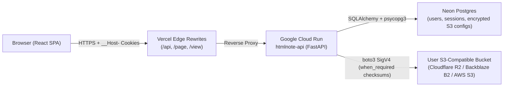

# HTMLNote API


Multi-tenant FastAPI backend for **HTMLNote** — an HTML-native notebook built for AI agents, LLMs, and humans who want rich interactive documents stored cleanly in their own S3-compatible object storage.

Companion frontend repository: **[tomar-ayush/htmlnote-web](https://github.com/tomar-ayush/htmlnote-web)**

---

## Why HTMLNote?

LLMs and coding agents consistently generate richer, cleaner, and less lossy structure in **standalone `.html` documents** than in Markdown — tables, callouts, diagrams, inline styles, SVGs, and interactive widgets render natively without bespoke plugins or broken syntax conversions.

HTMLNote gives every account a private, multi-tenant notebook workspace backed by **Bring-Your-Own S3-Compatible Storage**:
- Store notes directly as portable `.html` files in **Cloudflare R2**, **Backblaze B2**, **AWS S3**, **MinIO**, **DigitalOcean Spaces**, or any S3-API provider.
- Drop `.html` or `.htm` files straight into your bucket from any AI agent or CLI script (`[prefix/]<notebook>/<section>/<page>.html`) and they appear automatically in your workspace tree.
- Keep the compute tier **100% stateless** for zero-cost serverless deployment on **Google Cloud Run** + **Neon Serverless Postgres**.

---

## Architecture



---

## Key Features & Security Model

- **Universal S3 Compatibility (`app/store.py`)**: Configured with `signature_version="s3v4"`, `request_checksum_calculation="when_required"`, and `response_checksum_validation="when_required"` so `PutObject`, `CopyObject`, and `DeleteObjects` work seamlessly across AWS S3, Cloudflare R2, and Backblaze B2 without checksum header rejections.
- **Encrypted Credentials at Rest (`app/storage.py`)**: Per-tenant `secret_key_enc` is encrypted with Fernet (`cryptography`) derived from `SECRET_KEY` before saving to Postgres and is never returned in API responses.
- **SSRF Protection (`validate_endpoint`)**: Blocks plain HTTP (unless `ALLOW_INSECURE_S3=true`), embedded credentials, query/path injection, and any resolved loopback, RFC1918 private, link-local (`169.254.169.254`), or non-global IP addresses.
- **Authentication & CSRF (`app/auth.py`)**: `scrypt` password hashing, timing-safe token verification, login brute-force throttling, `__Host-hn_session` `HttpOnly` cookies, double-submit `__Host-hn_csrf` + `X-CSRF-Token` validation, and `ALLOWED_ORIGINS` pattern matching (`fnmatchcase`) for Vercel Edge Rewrites.
- **Dual Content-Security-Policy Sandboxing (`app/main.py`)**:
  - Edit mode (`/page/{path}`): `script-src 'none'; object-src 'none'; base-uri 'none'`
  - Preview mode (`/view/{path}`): `sandbox allow-scripts allow-popups allow-modals`
- **Automatic Version History**: Snapshots previous `.html` revisions under `.versions/<notebook>/<section>/<page>.html/<timestamp>.html` (5-minute cadence or forced on restore, retaining the latest 10 versions).

---

## S3 Bucket Layout

```text
[S3_PREFIX/]
├── <notebook>/
│   ├── .keep
│   └── <section>/
│       ├── .keep
│       └── <page>.html
└── .versions/
    └── <notebook>/
        └── <section>/
            └── <page>.html/
                └── <epoch_ms>.html
```

External agents or automation scripts only need to upload `[S3_PREFIX/]<notebook>/<section>/<page>.html` — HTMLNote discovers the notebook, section, and page automatically without requiring `.keep` marker files.

---

## API Reference

| Method | Endpoint | Description |
|---|---|---|
| `GET` | `/healthz` | Container health probe (`{"ok": true}`) |
| `GET` | `/api/auth/me` | Return active user & issue CSRF cookie |
| `POST` | `/api/auth/signup` | Validate signup details and send 6-digit email OTP via Brevo |
| `POST` | `/api/auth/verify-signup` | Verify 6-digit OTP, create user account, and start session |
| `POST` | `/api/auth/login` | Authenticate user with rate-limiting |
| `POST` | `/api/auth/logout` | Revoke session and clear cookie |
| `GET` | `/api/storage` | Get masked S3 configuration for current user |
| `POST` | `/api/storage/test` | Verify list, put, and delete permissions against S3 |
| `PUT` | `/api/storage` | Verify, encrypt secret key, and save S3 configuration |
| `DELETE` | `/api/storage` | Disconnect saved S3 configuration |
| `GET` | `/api/tree` | List notebooks, sections, and pages from bucket |
| `POST` | `/api/folder` | Create notebook (`parent=""`) or section (`parent="<nb>"`) |
| `POST` | `/api/page` | Create `.html` page inside a section |
| `PUT` | `/api/page?path=...` | Update page HTML and optionally force version snapshot |
| `POST` | `/api/rename` | Rename notebook, section, or page (including versions) |
| `DELETE` | `/api/item?path=...` | Delete notebook, section, or page (preserving parent markers) |
| `GET` | `/api/versions?path=...` | List up to 10 saved page versions |
| `GET` | `/api/version?path=...&id=...` | Fetch HTML for a specific saved version |
| `GET` | `/api/share?path=...` | Get public share link status for a page |
| `POST` | `/api/share` | Create or update public share link with optional expiry |
| `DELETE` | `/api/share?path=...` | Revoke public share link for a page |
| `GET` | `/api/drive/auth-url` | Generate Google OAuth URL for connecting Google Drive |
| `GET` | `/api/drive/callback` | Handle Google OAuth callback and provision `HTML Notebook` Drive folder |
| `POST` | `/api/drive/provider` | Switch active storage backend between `gdrive` and `s3` |
| `DELETE` | `/api/drive` | Disconnect Google Drive integration |
| `GET` | `/page/{path}` | Serve raw HTML with script-disabled edit CSP |
| `GET` | `/view/{path}` | Serve HTML inside sandboxed view CSP |
| `GET` | `/s/{token}` | Serve publicly shared page read-only inside sandboxed view CSP |

---

## Local Development & Tests

```bash
python3.13 -m venv .venv
source .venv/bin/activate
pip install -r requirements.txt

cp .env.example .env
# Edit .env with your Neon DATABASE_URL (keep COOKIE_SECURE=false locally)

alembic upgrade head
uvicorn app.main:app --reload --port 8000
```

Run the test suite (uses an in-memory SQLite database and an in-process S3 HTTP server):

```bash
python -m unittest discover -s tests -v
```

---

## Deploying to Google Cloud Run + Neon

### 1. Connect GitHub via GCP Cloud Build

1. In Google Cloud Console, open **Cloud Run -> Create Service -> Continuously deploy from a repository (Cloud Build)**.
2. Connect **`tomar-ayush/htmlnote-api`**, branch `^main$`, and build type **Dockerfile** (`/Dockerfile`).
3. Allow unauthenticated invocations (authentication is enforced per route by session cookies).

### 2. Environment Variables & Secrets in Cloud Run

Configure these 3 variables directly in Cloud Run (**Variables & Secrets**):

| Variable | Required | Default | Description |
|---|---|---|---|
| `DATABASE_URL` | Yes | — | Neon Postgres connection string (`postgresql://...` and `postgres://...` are normalized automatically to `postgresql+psycopg://`) |
| `SECRET_KEY` | Yes | — | Random secret used to Fernet-encrypt per-user S3 secret keys in Neon (`openssl rand -hex 32`) |
| `ALLOWED_ORIGINS` | Yes (with Vercel) | `""` | Comma-separated Vercel origins or wildcard patterns allowed to send proxied write requests (e.g. `https://htmlnote-web.vercel.app,https://htmlnote-web-*.vercel.app`) |
| `BREVO_API_KEY` | Yes (Production) | `""` | Brevo transactional API key (`xkeysib-...`) for sending signup OTP verification emails |
| `BREVO_SENDER_EMAIL` | Yes (Production) | `""` | Verified sender email address in your Brevo account |
| `BREVO_SENDER_NAME` | Optional | `HTML Notebook` | Display name used on signup verification emails |
| `PLATFORM_S3_ENDPOINT_URL` | Optional | `""` | Shared R2 / S3 endpoint for zero-setup 50 MB free tier |
| `PLATFORM_S3_REGION` | Optional | `auto` | Region for shared platform bucket |
| `PLATFORM_S3_BUCKET` | Optional | `""` | Shared bucket name (setting bucket + keys enables free managed storage) |
| `PLATFORM_S3_ACCESS_KEY_ID` | Optional | `""` | Access Key ID for shared platform bucket |
| `PLATFORM_S3_SECRET_ACCESS_KEY` | Optional | `""` | Secret Access Key for shared platform bucket |
| `PLATFORM_S3_PREFIX` | Optional | `users` | Prefix isolating managed users (`<prefix>/<user_id>/...`) |
| `PLATFORM_S3_FORCE_PATH_STYLE` | Optional | `false` | Set `true` if shared endpoint requires path-style addressing |
| `PLATFORM_FREE_MB` | Optional | `50` | Per-user free quota in MB on the shared platform bucket |
| `GOOGLE_CLIENT_ID` | Optional | `""` | Google OAuth Web Client ID for separate Google Drive sync |
| `GOOGLE_CLIENT_SECRET` | Optional | `""` | Google OAuth Web Client Secret for Google Drive sync |
| `GOOGLE_REDIRECT_URI` | Optional | Auto (`/api/drive/callback`) | Explicit OAuth redirect URI (set to `https://<frontend-domain>/api/drive/callback` when proxying through Vercel) |
| `COOKIE_SECURE` | Production | `true` (in `Dockerfile`) | Enables `__Host-` cookie prefix and `Secure` attribute |
| `ALLOWED_HOSTS` | Optional | `*` (in `Dockerfile`) | Comma-separated allowed `Host` headers |
| `ALLOW_INSECURE_S3` | Optional | `false` | Set `true` only for plain-HTTP local/private S3 servers |
